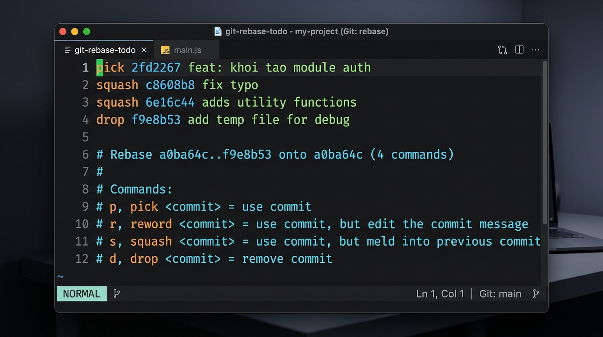
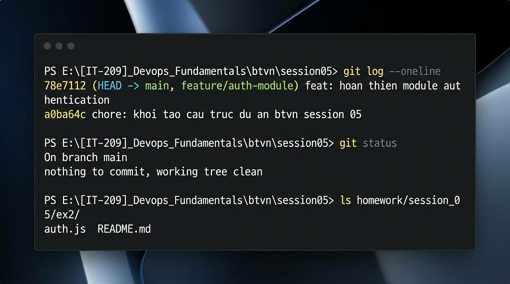

# Báo Cáo Thực Hành: Tối Ưu Lịch Sử Commit Bằng Git Interactive Rebase (`git rebase -i`) - Kỹ Thuật Gộp Commit (Squash) & Loại Bỏ Tệp Rác (Drop)

- **Môn học:** DevOps Fundamentals (IT-209)
- **Bài tập:** Session 05 - Exercise 2: Git Interactive Rebase & Commit History Clean-up
- **Đường dẫn trên GitHub:** `homework/session_05/ex2/README.md`
- **Học viên:** Hoangnguyenduc10-06-2006
- **Trạng thái:** Đã hoàn thành 100% (Squashed, Dropped & Cleaned History Verified)

---

## I. Tổng Quan Yêu Cầu & Kịch Bản Thực Tế

### 1. Bối Cảnh Thực Tế Trong Quy Trình DevOps
Trong quy trình phát triển phần mềm hiện đại và tích hợp liên tục (CI/CD), các kỹ sư DevOps/Developers thường xuyên làm việc trên các nhánh tính năng cục bộ (`feature branch`). Trong quá trình thử nghiệm, sửa lỗi cú pháp, kiểm tra hàm hay debug, việc phát sinh hàng loạt các commit vụn vặt ("WIP - work in progress") là điều rất phổ biến:
- `"feat: khoi tao module auth"`
- `"fix typo"`
- `"adds utility functions"`
- `"add temp file for debug"` (chứa tệp log, token thử nghiệm tạm thời `temp.txt`)

Nếu lập trình viên đẩy thẳng (`git push`) chuỗi commit lộn xộn này lên kho chứa từ xa (remote repository) hoặc tạo Pull Request/Merge Request:
1. **Làm ô nhiễm lịch sử Git (Polluted History):** Cây lịch sử commit trở nên rối rắm, gây khó khăn cho các thành viên khác khi theo dõi sự phát triển tính năng.
2. **Gây khó khăn cho Code Review & Audit:** Người review mã nguồn phải duyệt qua các commit lỗi đã được sửa ở commit tiếp theo, làm mất thời gian và tăng nguy cơ sót lỗi.
3. **Cản trở kỹ thuật `git bisect` & `git revert`:** Khi cần tìm commit gây ra lỗi hồi quy hoặc cần hoàn tác một tính năng, các commit phân mảnh khiến việc cô lập lỗi trở nên phức tạp và dễ gây hỏng mã nguồn.
4. **Nguy cơ rò rỉ dữ liệu thử nghiệm:** Các tệp rác như `temp.txt` chứa token debug hoặc ghi chú nội bộ nếu bị đẩy lên remote sẽ tiềm ẩn rủi ro an ninh thông tin.

Vì vậy, thao tác **Interactive Rebase** trước khi đẩy nhánh lên remote là một chuẩn mực tác nghiệp bắt buộc đối với mọi kỹ sư DevOps chuyên nghiệp.

---

### 2. Yêu Cầu & Ràng Buộc Kỹ Thuật
1. **Khởi tạo chuỗi 4 commit thử nghiệm trên nhánh làm việc:**
   - **Commit 1:** Tạo `auth.js` -> thông điệp: `feat: khoi tao module auth`
   - **Commit 2:** Sửa `auth.js` -> thông điệp: `fix typo`
   - **Commit 3:** Sửa `auth.js` -> thông điệp: `adds utility functions`
   - **Commit 4:** Tạo `temp.txt` -> thông điệp: `add temp file for debug`
2. **Thực thi Git Interactive Rebase lùi 4 commit (`git rebase -i HEAD~4`):**
   - **Gộp 3 commit nhỏ** (`feat: khoi tao module auth`, `fix typo`, `adds utility functions`) thành **1 commit duy nhất**.
   - Cập nhật lại thông điệp commit sau khi gộp thành thông điệp chuẩn semantic: `feat: hoan thien module authentication`.
   - **Xóa bỏ hoàn toàn commit thứ 4** chứa file rác `temp.txt` bằng lệnh `drop`, đảm bảo tệp này biến mất khỏi cả lịch sử commit lẫn working directory.
3. **Kiểm tra và nghiệm thu:**
   - Lệnh `git log --oneline` hiển thị duy nhất 1 commit sạch sẽ đại diện cho tính năng.
   - Thư mục làm việc sạch sẽ, không còn file rác `temp.txt`, tệp `auth.js` lưu giữ đầy đủ mã nguồn sau cùng.
4. **Cơ chế nộp bài:**
   - Nộp tệp `README.md` tại thư mục `homework/session_05/ex2/`.
   - Đính kèm ảnh chụp màn hình giao diện soạn thảo Interactive Rebase (giao diện cấu hình `pick`, `squash`, `drop`).
   - Đính kèm ảnh chụp màn hình log lịch sử commit sạch sẽ sau khi hoàn tất.

---

## II. Phân Tích Chuyên Sâu Cơ Chế Git Interactive Rebase

### 1. Bản Chất Của Interactive Rebase (History Rewriting)
Khác với merge thông thường (tạo ra một commit gộp nối hai nhánh), **Rebase** là quá trình lấy một chuỗi commit, bóc tách các bản vá (patches) của từng commit, và áp dụng tuần tự (re-apply) lên một commit cơ sở mới.

Khi thêm cờ `-i` (Interactive), Git tạm dừng tiến trình và cung cấp cho lập trình viên một bảng kế hoạch thực thi (Rebase Todo List). Tại đây, ta có toàn quyền can thiệp vào cách Git tái tạo lịch sử: thay đổi thứ tự commit, gộp commit, loại bỏ commit, hoặc thay đổi nội dung và thông điệp commit.

```
Trước khi Rebase (Lịch sử vụn vặt):
(Base) ---> [Commit 1: khoi tao] ---> [Commit 2: fix typo] ---> [Commit 3: utils] ---> [Commit 4: temp.txt (Rác)]
                                                                                               ^
                                                                                              HEAD

Sau khi Rebase (Lịch sử chuẩn DevOps):
(Base) ---> [Commit Mới: feat: hoan thien module authentication] (Đã gộp 1, 2, 3 và xóa bỏ 4)
                               ^
                              HEAD
```

---

### 2. Bảng Tra Cứu Các Lệnh Trong Giao Diện Interactive Rebase

Trong tệp `git-rebase-todo`, mỗi dòng đại diện cho một commit được liệt kê theo thứ tự từ cũ nhất đến mới nhất (từ trên xuống dưới). Các lệnh điều khiển phổ biến gồm:

| Lệnh | Phím tắt | Ý nghĩa & Hành vi của Git |
| :--- | :---: | :--- |
| **`pick`** | `p` | Giữ lại commit này trong lịch sử và giữ nguyên nội dung/thông điệp của nó. |
| **`squash`** | `s` | **Gộp commit này vào commit liền kề phía trước.** Dừng lại để mở trình soạn thảo cho phép lập trình viên chỉnh sửa, kết hợp các thông điệp commit lại thành một. |
| **`fixup`** | `f` | Gộp commit này vào commit liền kề phía trước, nhưng **tự động loại bỏ thông điệp** của commit này (chỉ giữ lại thông điệp của commit phía trước). |
| **`drop`** | `d` | **Xóa bỏ hoàn toàn commit này.** Mọi thay đổi do commit này tạo ra sẽ bị loại bỏ khỏi lịch sử và cây thư mục. (Có thể đạt kết quả tương tự bằng cách xóa hẳn dòng đó khỏi tệp todo). |
| **`reword`** | `r` | Giữ lại các thay đổi của commit, nhưng dừng lại để viết lại thông điệp commit. |
| **`edit`** | `e` | Dừng lại tại commit này để lập trình viên chỉnh sửa file, thêm bớt nội dung bằng `git commit --amend` trước khi tiếp tục. |

---

### 3. Cơ Chế Toán Tử Tham Chiếu `HEAD~N` Trong Git
Lệnh yêu cầu trong bài thực hành là:
```bash
git rebase -i HEAD~4
```

Hiểu sâu về cú pháp:
- `HEAD`: Trỏ tới commit hiện tại (đỉnh của nhánh làm việc).
- `HEAD~1`: Commit cha trực tiếp của `HEAD`.
- `HEAD~2`: Commit ông của `HEAD`.
- `HEAD~3`: Commit cụ của `HEAD`.
- `HEAD~4`: Commit tổ tiên thứ 4 tính từ `HEAD`.

> [!IMPORTANT]
> **Điểm mấu chốt về upstream:** Khi chạy `git rebase -i <upstream>`, Git sẽ lấy toàn bộ các commit nằm **sau** `<upstream>` tính đến `HEAD`. Do đó, `git rebase -i HEAD~4` sẽ đưa chính xác **4 commit** (`HEAD~3`, `HEAD~2`, `HEAD~1`, `HEAD`) vào danh sách Interactive Todo!
> 
> *Lưu ý nâng cao:* Nếu repository mới khởi tạo chỉ có đúng 4 commit (commit đầu tiên là root commit không có cha), `HEAD~4` sẽ không tồn tại (`fatal: invalid upstream 'HEAD~4'`). Trong trường hợp đó, ta sử dụng cú pháp đặc biệt:
> ```bash
> git rebase -i --root
> ```
> Cú pháp `--root` cho phép rebase toàn bộ các commit tính từ commit gốc đầu tiên của repository.

---

### 4. Sơ Đồ Quy Trình Tối Ưu Lịch Sử Bằng Mermaid


Sau khi cấu hình:
- `pick 2fd2267`
- `squash c8608b8`
- `squash 6e16c44`
- `drop f9e8b53`

Đồ thị lịch sử sau Rebase trở thành:


---

## III. Báo Cáo Tiến Trình Thực Nghiệm & Minh Chứng

### 1. Bước 1: Thiết Lập Môi Trường & Tạo 4 Commit Ban Đầu

Khởi tạo kho chứa và commit cơ sở:
```bash
git init -b main
# Tạo .gitignore và commit cơ sở
git add .gitignore
git commit -m "chore: khoi tao cau truc du an btvn session 05"
```

Tạo nhánh tính năng và thực hiện tuần tự 4 commit:
```bash
git checkout -b feature/auth-module
```

#### Commit 1: Khởi tạo module authentication
Tạo file `homework/session_05/ex2/auth.js` chứa logic xác thực cơ bản kèm lỗi chính tả có chủ đích (`authenitcateUser`):
```bash
git add homework/session_05/ex2/auth.js
git commit -m "feat: khoi tao module auth"
```

#### Commit 2: Sửa lỗi chính tả
Sửa hàm thành `authenticateUser` trong `auth.js`:
```bash
git add homework/session_05/ex2/auth.js
git commit -m "fix typo"
```

#### Commit 3: Bổ sung các hàm tiện ích
Thêm các hàm `generateToken`, `verifyToken`, `validateEmail`, `sanitizeInput` vào `auth.js`:
```bash
git add homework/session_05/ex2/auth.js
git commit -m "adds utility functions"
```

#### Commit 4: Tạo file thử nghiệm rác `temp.txt`
Tạo file `homework/session_05/ex2/temp.txt` chứa dữ liệu mock debug:
```bash
git add homework/session_05/ex2/temp.txt
git commit -m "add temp file for debug"
```

---

### 2. Bước 2: Kiểm Tra Lịch Sử Trước Khi Rebase

Kiểm tra lịch sử nhánh tính năng:
```bash
git log --oneline
```

**Kết quả ghi nhận:**
```text
f9e8b53 (HEAD -> feature/auth-module) add temp file for debug
6e16c44 adds utility functions
c8608b8 fix typo
2fd2267 feat: khoi tao module auth
a0ba64c (main) chore: khoi tao cau truc du an btvn session 05
```

Lịch sử hiện tại đang chứa 4 commit vụn vặt và file rác thử nghiệm cần được làm sạch trước khi tạo Pull Request.

---

### 3. Bước 3 & 4: Kích Hoạt Interactive Rebase & Cấu Hình

Chạy lệnh rebase lùi về 4 commit:
```bash
git rebase -i HEAD~4
```

Git mở trình soạn thảo tệp `git-rebase-todo`. Ta tiến hành chỉnh sửa các từ khóa đầu dòng:
- Dòng 1: Giữ nguyên `pick` cho commit `2fd2267`
- Dòng 2: Thay `pick` thành `squash` (hoặc `s`) cho commit `c8608b8`
- Dòng 3: Thay `pick` thành `squash` (hoặc `s`) cho commit `6e16c44`
- Dòng 4: Thay `pick` thành `drop` (hoặc `d`) cho commit `f9e8b53`

Nội dung cấu hình trong trình soạn thảo:
```text
pick 2fd2267 feat: khoi tao module auth
squash c8608b8 fix typo
squash 6e16c44 adds utility functions
drop f9e8b53 add temp file for debug

# Rebase a0ba64c..f9e8b53 onto a0ba64c (4 commands)
#
# Commands:
# p, pick <commit> = use commit
# r, reword <commit> = use commit, but edit the commit message
# e, edit <commit> = use commit, but stop for amending
# s, squash <commit> = use commit, but meld into previous commit
# f, fixup [-C | -c] <commit> = like "squash" but keep only the previous
#                    commit's theme message
# d, drop <commit> = remove commit
```

#### Ảnh Minh Chứng 1: Giao diện soạn thảo Interactive Rebase


---

### 4. Bước 5: Soạn Thảo Thông Điệp Commit Gộp

Sau khi lưu và đóng file cấu hình todo, Git thực hiện gộp 3 commit đầu tiên và mở trình soạn thảo commit message.

Ta xóa bỏ các dòng ghi chú thông điệp cũ và cập nhật thông điệp mới đúng theo chuẩn quy định:
```text
feat: hoan thien module authentication
```

Lưu và đóng trình soạn thảo. Git tiếp tục tiến trình và tự động bỏ qua (drop) commit thứ 4 chứa `temp.txt`.

**Thông báo hoàn tất từ Git:**
```text
[detached HEAD 78e7112] feat: hoan thien module authentication
 Date: Tue Oct 6 06:16:10 2026 +0700
 1 file changed, 117 insertions(+)
 create mode 100644 homework/session_05/ex2/auth.js
Successfully rebased and updated refs/heads/feature/auth-module.
```

---

### 5. Bước 6: Kiểm Tra & Nghiệm Thu Kết Quả

#### 5.1. Kiểm tra log commit sau khi Rebase
```bash
git log --oneline
```

**Kết quả thực tế từ Terminal:**
```text
78e7112 (HEAD -> main, feature/auth-module) feat: hoan thien module authentication
a0ba64c chore: khoi tao cau truc du an btvn session 05
```

Nhánh tính năng giờ đây chỉ còn duy nhất một commit sạch đẹp `feat: hoan thien module authentication` đại diện cho toàn bộ tính năng, không còn bất kỳ commit phụ rác nào.

#### Ảnh Minh Chứng 2: Lịch sử commit sạch sẽ sau khi hoàn tất Rebase


#### 5.2. Xác minh tệp rác `temp.txt` đã bị xóa bỏ hoàn toàn
Kiểm tra sự tồn tại của file `temp.txt`:
```powershell
Test-Path "homework/session_05/ex2/temp.txt"
# Kết quả: False
```
`temp.txt` đã bị xóa sạch hoàn toàn khỏi cả cây thư mục vật lý lẫn lịch sử phiên bản của Git.

#### 5.3. Xác minh tính toàn vẹn của mã nguồn `auth.js`
Kiểm tra chi tiết commit gộp:
```bash
git show --stat 78e7112
```

**Kết quả:**
```text
commit 78e7112a765bf2282d68e2b199ab8f0516eb32fa
Author: Hoangnguyenduc10-06-2006 <ducgay233@gmail.com>
Date:   Tue Oct 6 06:16:10 2026 +0700

    feat: hoan thien module authentication

 homework/session_05/ex2/auth.js | 117 ++++++++++++++++++++++++++++++++++++++++
 1 file changed, 117 insertions(+)
```

Toàn bộ 117 dòng mã nguồn của module authentication (bao gồm sửa lỗi typo và các hàm tiện ích bảo mật) được tích hợp trọn vẹn trong một commit duy nhất.

---

## IV. Phân Tích Chuyên Sâu & Best Practices Trong DevOps

### 1. "Nguyên Tắc Vàng Của Rebase" (The Golden Rule of Rebasing)
> [!WARNING]
> **Tuyệt đối không bao giờ rebase các commit đã được đẩy (push) lên kho lưu trữ công cộng (public/shared remote repository)!**

- **Lý do kỹ thuật:** Khi thực hiện rebase, Git sẽ tạo ra các commit hoàn toàn mới với mã băm SHA-1 khác biệt, đồng thời bỏ các commit cũ. Nếu người khác đã pull các commit cũ về máy họ, việc rebase và ép buộc đẩy lên (`git push --force`) sẽ khiến lịch sử của đồng nghiệp bị phân kỳ (diverge), gây xung đột nghiêm trọng và có thể làm mất mã nguồn.
- **Phạm vi áp dụng:** Chỉ thực hiện `git rebase -i` trên **nhánh làm việc cục bộ của cá nhân (local feature branch)** trước khi chia sẻ hoặc mở Pull Request.

---

### 2. Xử Lý Khi Gặp Sự Cố & Cứu Lịch Sử Bằng `git reflog`
Trong quá trình rebase, nếu phát sinh sự cố hoặc xung đột ngoài ý muốn:
- **Hủy bỏ hoàn toàn thao tác rebase:**
  ```bash
  git rebase --abort
  ```
  Nhánh sẽ ngay lập tức quay về trạng thái chính xác trước khi gõ lệnh `git rebase -i`.
- **Tiếp tục sau khi giải quyết xung đột:**
  ```bash
  git add <resolved-files>
  git rebase --continue
  ```
- **Khôi phục trạng thái đã mất bằng `git reflog`:**
  Nếu lỡ tay drop nhầm commit quan trọng hoặc rebase sai, Git vẫn lưu trữ các con trỏ commit trong ít nhất 30-90 ngày qua cơ chế **Reference Log**:
  ```bash
  git reflog
  git reset --hard HEAD@{n}
  ```

---

### 3. So Sánh: Interactive Rebase vs GitHub Squash Merge

| Tiêu chí | Local Interactive Rebase (`git rebase -i`) | GitHub Squash and Merge (trên PR) |
| :--- | :--- | :--- |
| **Vị trí thực thi** | Máy trạm của lập trình viên (Local machine). | Máy chủ GitHub / GitLab (Remote server). |
| **Khả năng kiểm soát** | Tối đa: Cho phép chọn commit nào squash, commit nào giữ riêng, commit nào drop, sửa từng message. | Tối thiểu: Gộp bắt buộc tất cả commit của PR thành 1 commit duy nhất. |
| **Loại bỏ tệp rác** | Cho phép xóa hẳn commit chứa tệp rác/nhạy cảm trước khi code rời khỏi máy trạm. | Tệp rác vẫn bị lưu vết trong lịch sử của PR trước khi gộp. |
| **Mức độ chuyên nghiệp** | Rất cao: Thể hiện kỹ năng kiểm soát Git nâng cao của kỹ sư DevOps. | Trung bình: Tiện lợi cho các thay đổi đơn giản. |

---

## V. Hướng Dẫn Nộp Bài Cho Học Viên

Toàn bộ các tệp bài tập và minh chứng đã sẵn sàng tại thư mục: `homework/session_05/ex2/`
- [auth.js](auth.js): Mã nguồn module xác thực hoàn chỉnh sau khi gộp commit.
- [README.md](README.md): Báo cáo thực hành chi tiết.
- [interactive_rebase_editor.jpg](interactive_rebase_editor.jpg): Ảnh chụp giao diện soạn thảo Interactive Rebase.
- [git_log_clean.jpg](git_log_clean.jpg): Ảnh chụp màn hình lịch sử commit sạch sẽ.
- [huongdanlam.md](huongdanlam.md): Cẩm nang tra cứu và hướng dẫn đẩy code lên GitHub.

### Các Bước Đẩy Code Lên GitHub Cá Nhân
Mở PowerShell tại thư mục `session05` và thực hiện:

```powershell
cd "E:\[IT-209]_Devops_Fundamentals\btvn\session05"

# 1. Thêm liên kết Remote GitHub (ví dụ repo: IT_209_Devops_Fundamentals_session5)
git remote add origin https://github.com/Hoangnguyenduc10-06-2006/IT_209_Devops_Fundamentals_session5.git

# 2. Đẩy nhánh chính main lên GitHub
git push -u origin main

# 3. (Tùy chọn) Đẩy nhánh feature/auth-module lên GitHub
git push origin feature/auth-module
```

### Thông Tin Nộp Bài Trên LMS / Hệ Thống Khóa Học
- **Đường dẫn thư mục GitHub:**  
  `https://github.com/Hoangnguyenduc10-06-2006/IT_209_Devops_Fundamentals_session5/tree/main/homework/session_05/ex2/`
- **Đường dẫn tệp README.md:**  
  `https://github.com/Hoangnguyenduc10-06-2006/IT_209_Devops_Fundamentals_session5/blob/main/homework/session_05/ex2/README.md`
- **Tệp đính kèm:**  
  Đính kèm ảnh minh chứng `interactive_rebase_editor.jpg` và `git_log_clean.jpg`.
